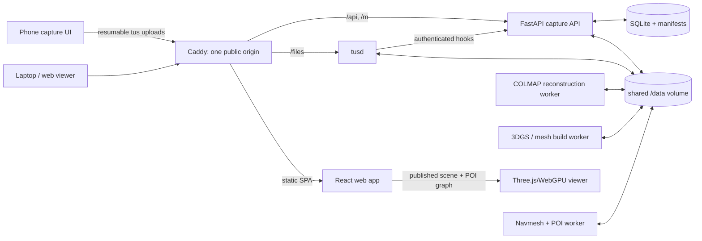

# Namma Space system design

## Outcome and scope

Namma Space turns a guided smartphone capture of an indoor space into a browser-based digital twin. The first deliverable is a reliable local pipeline for **photo capture -> calibrated sparse model -> web-ready reconstruction artifact**. It then grows into POI search and obstacle-aware desktop routing. Live AR guidance is deliberately last: it depends on an accurate map, stable localisation, and a tested navigation graph.

The current repository already owns the capture boundary: pairing, resumable uploads, storage, thumbnails, manifests, and live upload status. This design preserves that work and adds compute as a separate batch concern.

## Capture SOP

For the first evaluation, capture one room or a connected small office area with still photos, not a single long video:

1. Walk one slow perimeter loop, holding the phone level and taking a photo every 0.5-1 m. Keep 70-80% overlap between adjacent photos.
2. Capture a second loop from a different height/angle, plus doorways, corners, and texture-poor regions. Avoid people and moving screens.
3. Include overlap when moving between rooms. Add a short doorway-to-doorway sequence for every connection.
4. Upload an optional floor plan and record one known metric distance; this lets a later floor-plan alignment stage establish scale.
5. Review the capture count and thumbnails before starting reconstruction. If a section has blur or low overlap, re-capture it before processing.

Video remains supported at ingestion, but video frame extraction, blur filtering, and HEIC normalisation are separate workers. Treating them as explicit stages makes their quality measurable and avoids silently passing poor frames into COLMAP.

## Architecture



**Trust boundaries:** Caddy is the sole public entry point. `tusd`, the FastAPI hook endpoint, the SQLite database, and workers stay on the private Docker network. The API and tusd share exactly one `/data` filesystem so post-finish can atomically rename multi-gigabyte files. An owner token protects session reads; a short-lived pair token grants upload-only access.

## Docker-first local topology

`compose.yaml` implements the current local working slice. It is the source of truth
for service boundaries, not a commitment to a hosted deployment.

| Service | Responsibility | Public |
| --- | --- | --- |
| `gateway` | one origin; routes static UI, API, and tus traffic | `localhost:8080` |
| `frontend` | production-built React SPA | no |
| `api` | session, token, manifest, SSE, and tusd hooks | no |
| `tusd` | resumable mobile uploads | no |
| `colmap` profile | one-shot CPU/GPU reconstruction worker | no |

The `colmap` service is an official `colmap/colmap` Docker image, downloaded by Docker on first use. It is not started with `up`, because reconstruction can consume all available CPU/GPU and must not harm an upload in progress. The initial script produces an auditable sparse point cloud and calibrated cameras from JPEG/PNG captures. This is intentionally not presented as a finished photorealistic asset.

## Reconstruction pipeline and contracts

Every stage writes below one immutable session root and records a small metadata document (inputs, command/image version, timestamps, output paths, quality metrics, and error) before publishing its result.

```text
/data/sessions/<session-id>/
  raw/                         original immutable phone files
  extracted_frames/            blur-filtered stills per video (extract_frames)
  processed/                   normalized photos + inputs.json hand-off
  reconstruction/
    frames/                    selected/normalised images (future worker)
    colmap/<run-id>/           database, sparse model, PLY export
    render/                    Gaussian splat or compressed mesh (future worker)
    navigation/                floor plane, obstacles, navmesh, POIs (future worker)
  manifest.json                capture-facing derived view
```

1. **Validate and prepare:** reject corrupt files, extract video frames at a fixed cadence, score blur, normalise orientation/HEIC, and retain the selected-frame manifest.
2. **Calibrate (COLMAP):** feature extraction, sequential/exhaustive matching selected by capture type, mapper, and quality gates: registered-image ratio, reprojection error, connected components, and point count.
3. **Create the web scene:** run Gaussian Splatting/NeRF for visual fidelity or generate a textured mesh for broad compatibility. Produce progressive LODs plus a small scene manifest. The viewer initially loads a low-detail asset then refines it.
4. **Make it navigable:** extract/confirm floor plane, derive walls and obstacle masks from mesh/depth/floor plan, generate a 2D walkable grid/navmesh, and create graph nodes at POIs and doorway transitions.
5. **Publish:** atomically switch `published.json` to the validated artifact version. The web app reads only a published revision, never a partially-written worker directory.

Workers should become queue jobs before the shared local volume is replaced: `capture.ready -> prepare -> colmap -> render -> navmesh -> publish`. A database job table with idempotency key `(session_id, stage, input_revision)` is enough locally; the queue can later become Redis/SQS without changing the stage contract.

## POIs, search, and routing

POIs are not raw mesh coordinates alone. Store a stable record with `id`, display name, aliases, category, floor, 3D anchor, nearest nav-node, optional region polygon, and artifact revision. Search uses SQLite FTS locally (aliases and labels); it resolves a POI to a nav-node. The user position is projected to the nearest valid navmesh node, then A* runs on the floor-constrained graph with edge costs for distance, stairs, and blocked regions. The viewer draws the returned polyline in 3D and follows it in first-person mode.

The routing graph is revisioned with its scene. A POI cannot point into a different model revision; publishing validates that every POI anchor and graph node exists. Dynamic closures later become temporary edge penalties, not edits to reconstructed geometry.

## Viewer and AR sequence

For Round 1, use a Three.js/WebGPU viewer with pointer-lock mouse look, WASD/collision movement, and a compressed scene/splat loader. Capture a repeatable baseline: time to first render, FPS on an ordinary laptop, number of images registered, and reconstruction time.

For Round 2, add a POI search panel, click-to-focus POIs, A* path preview, and collision-free desktop navigation. Validate paths against a manually reviewed floor-plan overlay before demoing them.

AR is a bonus stage. An ARCore/ARKit web/native client estimates live pose, relocalises against visual anchors/camera poses, transforms it into the published map coordinate frame, and overlays the same navigation polyline. When localisation confidence is low, the UI must say so and offer a visual re-anchor rather than issuing incorrect directions.

## Deployment status

The project is local-first. Oracle Cloud is not a viable option because account
creation requires a credit card, which is unavailable to this project. No public
host, domain, VM, DNS configuration, or TLS deployment is currently planned.

Use Docker Compose on the development machine for demos and development. A phone on
the same network can use the laptop's LAN address as `PUBLIC_BASE_URL`; this remains
local-network testing, not a public deployment. Keep the Compose topology portable so
a future hosting decision can reuse its API, tusd, gateway, and shared-volume
boundaries. Choose that host only when the project has a viable account and a need to
publish it.

## Current implementation boundary

Implemented now: capture, tokenised resumable uploads, manifests, local Compose,
the Process job (which normalises photos into `processed/inputs.json` and, via
`pipeline(videos)`, extracts blur-filtered frames from each video into
`extracted_frames/`), a Docker-downloaded COLMAP worker, and sparse
reconstruction from JPEG/PNG photos.
Not implemented yet: HTML/video frame filtering, dense/photorealistic rendering, a
3D viewer, POIs, navmesh/pathfinding, job orchestration, AR, and public hosting.
Those are separate future decisions; hosting is intentionally deferred.
